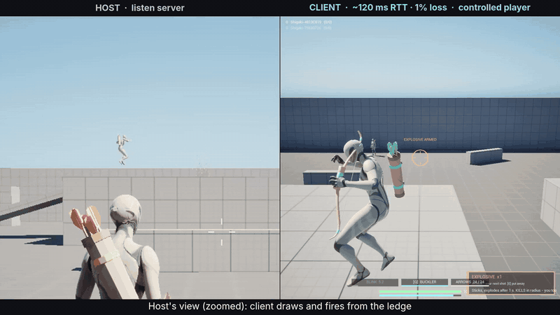
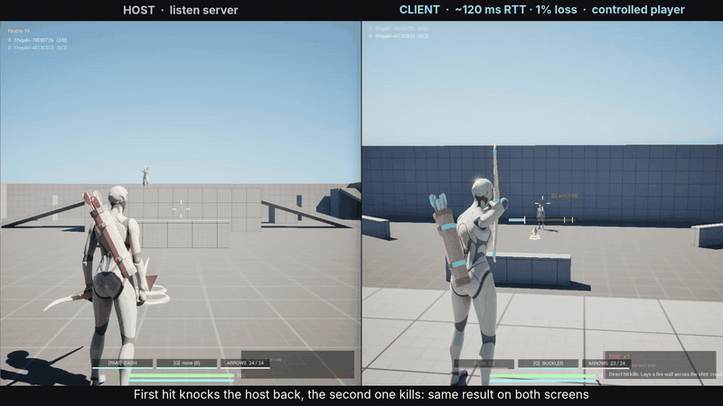
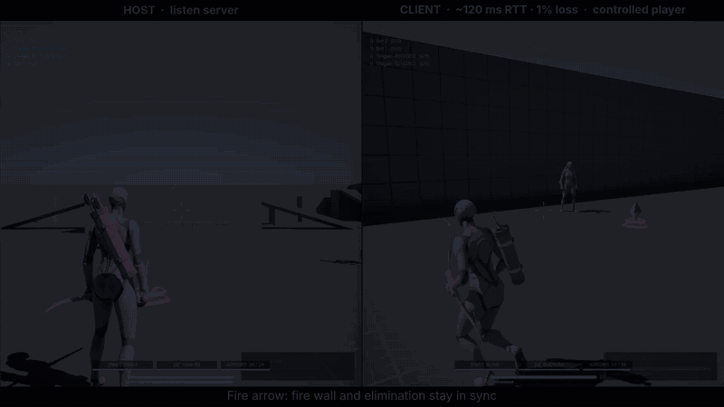
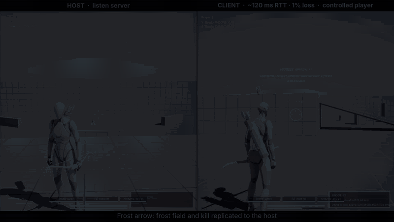

# ARCHER — Multiplayer Archery Arena (Prototype)

**Unreal Engine 5.8 · C++ · Listen-server multiplayer · Solo project**

ARCHER is a third-person party arena where every shot is a slow, visible projectile: you win by predicting where people *will be*, not by reflexes alone. This repository is a portfolio page for the gameplay prototype — a playable build is available on request; source code is private.

> Built by **Leandro Shigaki**, gameplay & UI programmer (4 years of Unreal Engine in production, two multiplayer productions).
> Prototype started 31 Oct 2026; everything shown here is grey-box and placeholder art.

<!--
  VIDEOS: GitHub only plays videos uploaded through its editor.
  Edit this README on github.com, drag ARCHER_showcase_720p.mp4 and ARCHER_netcode_720p.mp4
  into the text where the placeholders are, and GitHub will replace them with a player link.
-->

## Gameplay showcase

https://github.com/user-attachments/assets/31682ee6-e6b0-49a4-94ad-6fe582029e88

*46 s highlight reel — 1 player vs 3 practice bots, free-for-all, first to 15.*

| Fire arrow | Stun arrow | Buckler |
|---|---|---|
|  |  |  |

## Networking

https://github.com/user-attachments/assets/12112941-4491-4641-8960-8fbe3a478756

*Two instances on one PC: left is the listen-server host, right is the client I control, with **~120 ms round trip and 1% packet loss** simulated in both directions (`NetEmulation.PktLag 60`, `PktLoss 1` on each side).*

| Host watches the shot land | Knockback, then the kill |
|:---:|:---:|
|  |  |

| Fire wall in sync | Frost field in sync |
|:---:|:---:|
|  |  |

### How it works

**Arrows: event-based, not replicated actors.**
Arrows are slow and long-lived, so replicating them as actors would mean a stream of position updates per arrow plus the latency before the shooter even sees their own shot. Instead:

1. The shooter spawns its arrow **immediately** on the local machine (no input delay).
2. `Server_Fire` sends just the shot: origin, velocity, gravity scale, shot ID and arrow type (quantized).
3. The server validates it (alive, ammo/charges), stores the shot, and `Multicast_Fire`s it.
4. Every other machine spawns a **cosmetic copy** and simulates the same ballistic path locally.

One RPC per shot, regardless of flight time. A visual offset blends the drawn arrow from the bow onto the true path, so it leaves the bow but lands where the crosshair pointed.

**Hits: shooter-reported, server-validated.**
Arrows trace each character's physics-asset bodies, so a hit carries a bone name (headshots, pinning the arrow to the right limb). The shooter's copy reports the hit with `Server_ReportHit`; the server checks it against the stored shot (exists, not too old, victim alive and not spawn-protected, reported point close to the victim's real position) before applying damage. Buckler blocks, piercing and all area effects (explosion, stun blast, frost field, fire wall) are resolved on the server and multicast.

**Movement: client-predicted.**
A custom `UCharacterMovementComponent` predicts sprint, the draw slowdown, crouch and slide through compressed flags and custom saved moves (the slide timer is part of the saved move, so replays after a correction stay consistent). Knockback is applied by the owning client so it isn't fought by prediction.

**Live tuning across the session.**
Gameplay values are `archer.*` console variables with an in-game Tuning screen. The host's values are copied into the GameState every 0.5 s and replicated, so a playtest can be retuned live without restarting.

### Deliberate prototype trade-offs (and the production plan)

| Prototype | Why | Production |
|---|---|---|
| Shooter decides the hit, server sanity-checks | Feels perfect for the shooter; fine among friends | Server-authoritative hits with lag compensation (rewind victims' hitboxes to the shooter's view time) |
| Each machine simulates arrows independently | Zero bandwidth during flight | Deterministic fixed-step ballistic sim shared by the trajectory preview, the predicted arrow and the server |
| Stamina / landing lag not in saved moves | Small drift on correction is acceptable for now | Add them to the saved move / move data |
| Listen server | Simplest playtest setup | Dedicated-server build target |

## Systems in the prototype

- **Bow:** hold-to-draw with a charge curve; partial draws stagger, full draws kill. Four bow presets (Recurve, Compound, Longbow, Shortbow) with different power, draw speed and mobility.
- **Special arrows** (one equipped, recharging): Fire (fire wall), Frost (slowing field), Stun/Concussion, Explosive, Sticky, Split, Piercing, Rope.
- **Mobility:** Dash, Blink, Grapple, each with its own cooldown.
- **Gear:** Buckler (raised for 3 s, eats the first arrow; headshots and explosions go through); Smoke and Bear Trap in progress.
- **Combat feel:** ragdoll deaths with arrows pinned to the hit bone (and to walls), headshot detection, hit markers, kill feed, death cam.
- **Practice bots:** server-only C++ state machine driving the same character class as players (so all movement and replication rules apply): line-of-sight targeting, ballistic lead aim with skill-scaled error, dodging when the target is drawing.
- **Match flow:** FFA or N-team modes, first to X, respawn with spawn protection, loser-weighted pickup crates.
- **Tooling:** loadout screen, live Tuning screen, hitbox and movement debug views, build-info overlay. UI and HUD are written in C++.

## Tech

Unreal Engine 5.8 · C++ (gameplay, UI, AI) · Steam sessions through my own reusable plugin kit (networking, UI and core utilities) · tested under simulated latency from day one.

## Contact

<!-- Add your links -->
- LinkedIn: [leandro-shigaki](https://www.linkedin.com/in/leandro-shigaki/)
- Email: leandroshigaki@gmail.com
